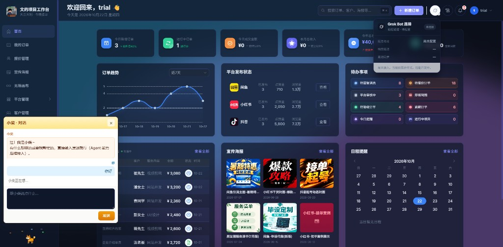

#  文的项目工作台

[](CHANGELOG.json)
[](https://nodejs.org)
[](https://expressjs.com)
[](ARCHITECTURE.md)
[](#功能)
[](#启动)
[](#许可)

本机接单工作台。桌面端管客户、订单、报价、项目、发帖和素材；手机端查进度、改状态。两边共用同一套后端，数据按账号分开存放。

<p>
  
  
</p>


## 功能

- **桌面端**：首页看板、订单、报价、宣传海报、无限画布、闲鱼 / 小红书 / 抖音发帖、客户、数据统计、项目看板、账号、网址收藏、简历、备忘、日期提醒、设置
- **设置**：外观、侧栏菜单开关、访问密码、备份与恢复、导出、回收站
- **移动端**：工作台（开发小账）、订单、待办、客户、项目、报价、素材、发帖、链接收藏、设置

更新记录在 [`CHANGELOG.json`](CHANGELOG.json)，应用顶栏可以对比本地和 GitHub 上的版本。分层规则见 [`ARCHITECTURE.md`](ARCHITECTURE.md)。

## 启动

需要 [Node.js](https://nodejs.org) 18+。Windows 双击 `start.bat`，打开 <http://localhost:3456>。停止用 `stop.bat`。

首次启动会在控制台打印用户名（默认 `admin`）和密码，也可用 `APP_USERNAME` / `APP_PASSWORD` 指定。试用账号默认 `trial`。

```bash
cd backend && npm install && npm start
```

移动端另开一个终端，或双击 `start-mobile.bat`（需后端已启动）：

```bash
cd mobile-pwa && npm install && npm run dev
```

地址是 <http://localhost:3460>，接口代理到 3456。

提交前跑 `node tools/check-all.js`。

## 许可

MIT License
